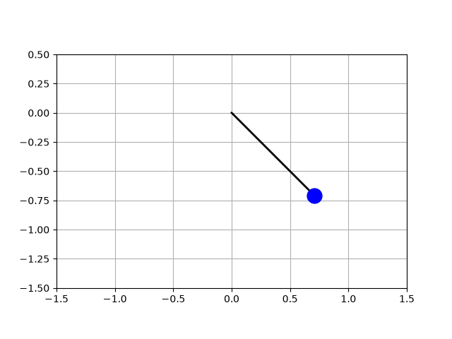
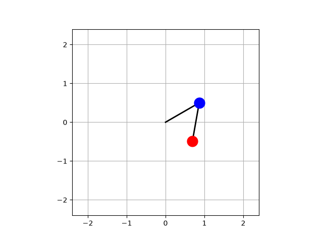
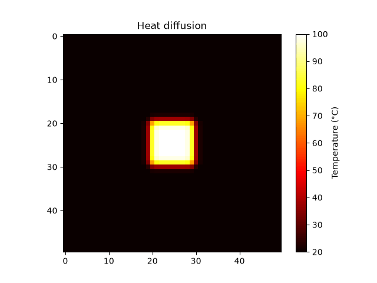
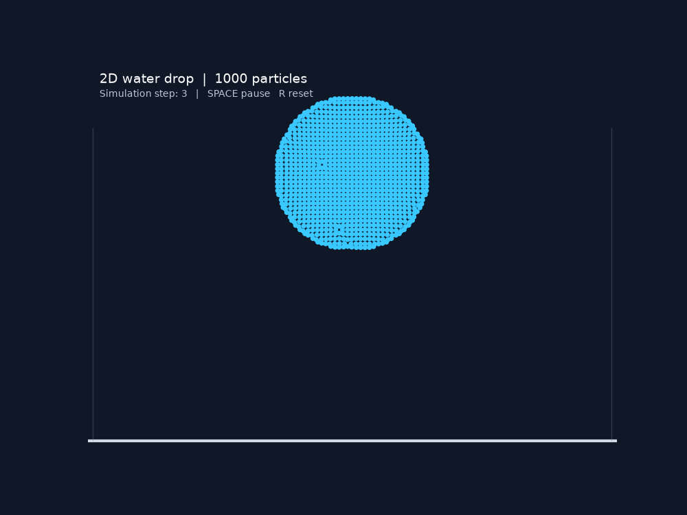

# Physics Simulations

A collection of small, **from-scratch physics simulations in Python**. Each experiment starts with a physical model, translates it into equations, solves those equations numerically, and visualizes the result as an animated GIF.

The goal is to learn how numerical simulation works, from classical mechanics and partial differential equations to a simple particle-based fluid model. Each simulation has a **step-by-step mathematical tutorial** linked at the end of this README.

## Simulations

### 1. Simple pendulum

An ideal pendulum oscillating under gravity, without friction. Its nonlinear angular equation is integrated with SciPy's `solve_ivp`.

[](docs/pendulum.md)

**[Python source](simulations/pendulum.py)** · **[Read the derivation](docs/pendulum.md)**

### 2. Double pendulum

Two connected pendulums described with **Lagrangian mechanics**. Their coupled nonlinear equations produce sensitive, sometimes chaotic trajectories.

[](docs/double_pendulum.md)

**[Python source](simulations/double_pendulum.py)** · **[Read the derivation](docs/double_pendulum.md)**

### 3. Heat diffusion

Heat spreads across a two-dimensional plate. The **heat equation** is approximated on a regular grid using an explicit finite-difference scheme.

[](docs/heat_diffusion.md)

**[Python source](simulations/heat_diffusion.py)** · **[Read the derivation](docs/heat_diffusion.md)**

### 4. Water drop simulation

A falling disk of **1,000 interacting particles** that deforms and splashes on impact. This is an educational, particle-based **double-density relaxation** solver—not a full Navier–Stokes implementation.

[](docs/water_drop_simulation.md)

**[Python source](simulations/water_drop_simulation.py)** · **[Read the algorithm](docs/water_drop_simulation.md)**

## Requirements

- **Python 3.10+** (recommended; a recent, supported Python version)
- **NumPy** — arrays and numerical calculations
- **SciPy** — ODE integration (`solve_ivp`) and efficient particle-neighbor search (`cKDTree`)
- **Matplotlib** — plotting and animation
- **Pillow** — writing animated GIFs

The Python packages are listed in [`requirements.txt`](requirements.txt). **FFmpeg is not required** for GIF export; it would only be needed if MP4 output were added later.

## Setup

Clone the repository and enter its directory:

```bash
git clone https://github.com/victrolles/physics-simulations.git
cd physics-simulations
```

Create a virtual environment:

```bash
python -m venv .venv
```

Activate it:

**Windows PowerShell**

```powershell
.venv\Scripts\Activate.ps1
```

**Windows Command Prompt**

```bat
.venv\Scripts\activate.bat
```

**macOS / Linux**

```bash
source .venv/bin/activate
```

Install the dependencies:

```bash
python -m pip install --upgrade pip
python -m pip install -r requirements.txt
```

> On systems where the command is `python3` rather than `python`, use `python3` for the environment-creation step.

## Run the simulations

**Run these commands from the repository root**, not from the `simulations/` directory. Each script saves its result to `videos/` and exits; the animations are not displayed in an interactive window.

**Simple pendulum**

```bash
python simulations/pendulum.py
```

**Double pendulum**

```bash
python simulations/double_pendulum.py
```

**Heat diffusion**

```bash
python simulations/heat_diffusion.py
```

**Water drop**

```bash
python simulations/water_drop_simulation.py
```

The generated files are:

```text
videos/
├── pendulum.gif
├── double_pendulum.gif
├── heat_diffusion.gif
└── water_drop_simulation.gif
```

Running a script overwrites its corresponding GIF. GIF generation can take some time, especially for the particle-based water simulation. The GIF frame rate controls **playback speed** and does not necessarily equal the model's simulated time step.

## Project structure

```text
physics-simulations/
├── simulations/
│   ├── pendulum.py
│   ├── double_pendulum.py
│   ├── heat_diffusion.py
│   └── water_drop_simulation.py
├── videos/
│   ├── pendulum.gif
│   ├── double_pendulum.gif
│   ├── heat_diffusion.gif
│   └── water_drop_simulation.gif
├── docs/
│   ├── pendulum.md
│   ├── double_pendulum.md
│   ├── heat_diffusion.md
│   └── water_drop_simulation.md
├── requirements.txt
├── LICENSE
└── README.md
```

## Documentation: understand the physics, step by step

The tutorials explain how the mathematical equations are derived, why the numerical methods work, and how the code turns the solutions into an animation.

1. **[Simple pendulum — forces, angular acceleration, numerical integration](docs/pendulum.md)**  
   From gravity and an initial angle to $\ddot\theta=-(g/L)\sin\theta$, a first-order ODE system, Cartesian coordinates, and an animation.

2. **[Double pendulum — coordinates, velocities, and Lagrange's equations](docs/double_pendulum.md)**  
   Derive the positions and velocities of both masses, kinetic and potential energy, both coupled equations, and their matrix form $A\boldsymbol\alpha=B$.

3. **[Heat diffusion — the heat PDE and finite differences](docs/heat_diffusion.md)**  
   Derive the two-dimensional heat equation, discretize the Laplacian, implement the five-point stencil, and check numerical stability.

4. **[Water drop — a 1,000-particle fluid algorithm](docs/water_drop_simulation.md)**  
   Build the drop, find neighbors, apply gravity and viscosity, estimate densities and pressures, relax positions, and handle collisions.

## Scope and limitations

These are **educational simulations**, not validated industrial solvers. The pendulums omit damping and friction; the heat model uses a simplified 2D grid with fixed boundary cells; the water model is a qualitative particle approximation with parameters in display/simulation units. The implementation is intentionally small enough to study and modify.

## License

Released under the [MIT License](LICENSE). Copyright © 2026 Victor Goudal.

Created to explore numerical physics simulation and as a foundation for future **AI-for-simulation / digital-twin** experiments.
